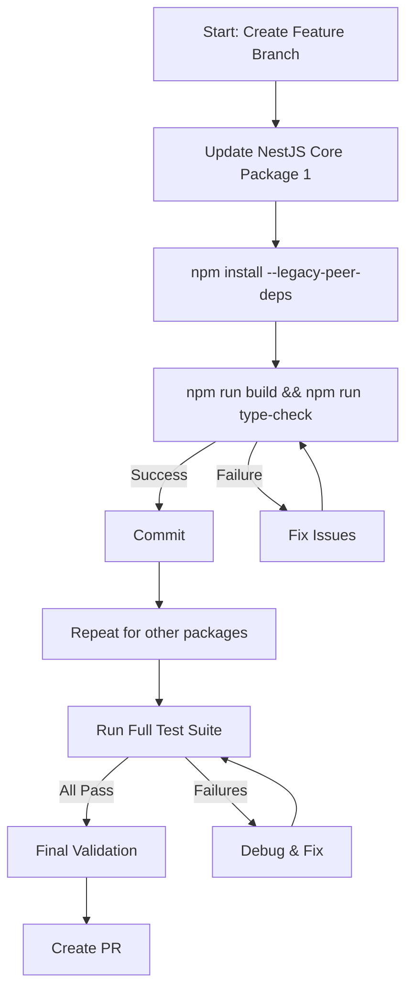

# Dependency Update Analysis - estore-api

**Analysis Date:** November 25, 2026  
**Current Project Version:** 1.9.0  
**Node.js Target:** >=24.17.0 | **npm Target:** >=11.3.0

---

## Executive Summary

The estore-api project has **13 significantly outdated dependencies**, primarily in the NestJS ecosystem. Major version updates available for core packages represent approximately **1-2 major versions** behind the latest releases. The update effort is **moderately complex** due to:

1. **Breaking changes in NestJS 12.x** (from 11.x)
2. **TypeScript 7.x compatibility** (from 6.x)
3. **Existing TypeScript compilation errors** that may mask additional issues
4. **Dependency interconnectedness** in the NestJS ecosystem

---

## Outdated Dependencies Summary

### Production Dependencies

| Package | Current | Latest | Gap | Effort |
|---------|---------|--------|-----|--------|
| `@nestjs/axios` | 4.0.1 | 12.0.2 | +8 minor | 🟡 Medium |
| `@nestjs/cache-manager` | 3.1.0 | 12.0.5 | +9 minor | 🟡 Medium |
| `@nestjs/common` | 11.1.19 | 12.6.1 | +1 minor | 🟢 Low |
| `@nestjs/config` | 4.0.4 | 12.1.1 | +8 minor | 🟡 Medium |
| `@nestjs/core` | 11.1.19 | 12.6.1 | +1 minor | 🟢 Low |
| `@nestjs/passport` | 10.0.3 | 12.0.2 | +2 minor | 🟡 Medium |
| `@nestjs/platform-express` | 11.1.19 | 12.6.1 | +1 minor | 🟢 Low |
| `@nestjs/swagger` | 11.2.7 | 12.1.2 | +1 minor | 🟢 Low |
| `typescript` | 6.0.2 | 7.0.2 | +1 major | 🟡 Medium |
| `nock` | 14.0.12 | 15.0.6 | +1 major | 🟡 Medium |
| `@types/supertest` | 2.0.16 | 7.2.1 | +5 major | 🔴 High |

### Development Dependencies (Outdated)
- `@nestjs/schematics`: 11.0.10 → 12.0.16 (+1 minor, low effort)
- `@nestjs/testing`: 11.1.19 → 12.6.1 (+1 minor, low effort)

---

## Detailed Analysis by Component

### 1. **NestJS Core Ecosystem** (Highest Priority)
**Current:** 11.1.19 | **Latest:** 12.6.1

#### Status:
- ✅ **Within same major version** for `@nestjs/core`, `@nestjs/common`, `@nestjs/platform-express`
- ✅ **Small jump** from 11.x → 12.x (NestJS follows semantic versioning for framework versions)
- ✅ **Dependency compatibility** is generally maintained across minor versions

#### Breaking Changes to Anticipate:
1. **Module export changes** - Some internal exports may have changed
2. **Decorator behavior** - `@nestjs/swagger` integration may have updates
3. **Middleware/Guard signatures** - Unlikely but possible in minor versions
4. **Platform Express integration** - Possible request/response type changes

#### Mitigation:
```bash
# Start with:
npm update @nestjs/core @nestjs/common @nestjs/platform-express --save --legacy-peer-deps

# Verify after update:
npm run build
npm run unit-test
npm run api-test
```

---

### 2. **NestJS Ecosystem Packages** (Secondary Priority)

#### `@nestjs/axios` (4.0.1 → 12.0.2)
- **Gap:** +8 minor versions
- **Issue:** Significant version gap suggests substantial changes
- **Action Required:**
  - Review HTTP client usage in codebase (search for `HttpModule`)
  - Check for deprecated decorators or class methods
  - Verify axios configuration compatibility

#### `@nestjs/config` (4.0.4 → 12.1.1)
- **Gap:** +8 minor versions
- **Impact:** Configuration loading may have breaking changes
- **Action Required:**
  - Review `ConfigModule.forRoot()` usage
  - Check for `.env` file loading patterns
  - Verify validation schema compatibility

#### `@nestjs/cache-manager` (3.1.0 → 12.0.5)
- **Gap:** +9 minor versions
- **Impact:** Cache manager API may have changed
- **Action Required:**
  - Audit cache decorator usage (`@Cacheable`, etc.)
  - Review cache configuration in app setup
  - Test cache invalidation patterns

#### `@nestjs/passport` (10.0.3 → 12.0.2)
- **Gap:** +2 minor versions
- **Impact:** Medium - authentication strategy integration
- **Action Required:**
  - Review authentication guards
  - Check strategy configuration
  - Test header API key authentication flow

#### `@nestjs/swagger` (11.2.7 → 12.1.2)
- **Gap:** +1 minor version (smallest gap in NestJS ecosystem)
- **Impact:** Low - mostly documentation generation
- **Action Required:**
  - Verify OpenAPI schema generation
  - Check for deprecated decorators
  - Test Swagger UI rendering

#### `@nestjs/schematics` (11.0.10 → 12.0.16)
- **Gap:** +1 minor version
- **Impact:** Low - development-only code generation
- **Action Required:**
  - Affects CLI code generation only
  - Run `nest generate` to verify generator still works

#### `@nestjs/testing` (11.1.19 → 12.6.1)
- **Gap:** +1 minor version
- **Impact:** Low - test utilities
- **Action Required:**
  - Verify test module creation works
  - Ensure mocking utilities compatible

---

### 3. **TypeScript** (6.0.2 → 7.0.2)
- **Gap:** +1 major version
- **Status:** ⚠️ **KNOWN ISSUE:** TypeScript 7 may have stricter type checking
- **Current State:** Already have 1 TypeScript compilation error (see section below)

#### Issues to Resolve:
1. **Existing Error:** Mock stream type incompatibility in `test/support/mocks/dtfs-storage-client.service.mock.ts:46`
   - `ReadableStream` vs `NodeJSReadableStream` type mismatch
   - Likely caused by Azure SDK version and TypeScript version interaction
   
2. **TypeScript 7 Changes:**
   - Stricter type checking in some edge cases
   - Possible import/export refinements
   - Better JSDoc parsing

#### Action Required:
```bash
# 1. First resolve the existing TypeScript error
# 2. Update TypeScript
npm install --save-dev typescript@7.0.2

# 3. Run type checking
npm run type-check

# 4. Fix any new errors
# Expected: May need to adjust mock types in DTFS storage tests
```

---

### 4. **Testing Dependencies**

#### `@types/supertest` (2.0.16 → 7.2.1)
- **Gap:** +5 major versions (SIGNIFICANT!)
- **Status:** This is unusual - suggests @types/supertest was way behind
- **Action Required:**
  - Review API test file imports
  - Verify type definitions match supertest API
  - Check for deprecated test helper methods
  - Re-run full API test suite: `npm run api-test`

#### `nock` (14.0.12 → 15.0.6)
- **Gap:** +1 major version
- **Status:** HTTP mocking library
- **Action Required:**
  - Verify mocking syntax in tests
  - Check for deprecated matcher patterns
  - Test all HTTP client mocking scenarios

---

## Implementation Strategy

### Phase 1: Preparation (1-2 hours)
- [ ] Create feature branch: `chore/update-dependencies`
- [ ] Document current test status (baseline)
- [ ] Identify all files using NestJS modules
- [ ] Review NestJS 12 release notes

### Phase 2: Core Updates (2-3 hours)
1. **Update NestJS core packages:**
   ```bash
   npm update @nestjs/core @nestjs/common @nestjs/platform-express \
              @nestjs/testing @nestjs/schematics --save --legacy-peer-deps
   ```

2. **Update TypeScript:**
   ```bash
   npm install --save-dev typescript@7.0.2
   ```

3. **Run initial validation:**
   ```bash
   npm run type-check
   npm run build
   npm run lint
   ```

### Phase 3: Secondary Updates (2-3 hours)
1. **Update remaining NestJS ecosystem packages:**
   ```bash
   npm update @nestjs/axios @nestjs/cache-manager @nestjs/config \
              @nestjs/passport @nestjs/swagger --save --legacy-peer-deps
   ```

2. **Update testing dependencies:**
   ```bash
   npm install --save-dev @types/supertest@7.2.1 nock@15.0.6
   ```

3. **Install clean slate:**
   ```bash
   rm -rf node_modules package-lock.json
   npm install --legacy-peer-deps
   ```

### Phase 4: Testing & Validation (3-4 hours)
- [ ] Run full test suite: `npm run unit-test` + `npm run api-test`
- [ ] Type checking: `npm run type-check`
- [ ] Linting: `npm run lint`
- [ ] Manual smoke test: `npm run start:dev` and verify endpoints
- [ ] Check for console warnings/deprecations

### Phase 5: Fixing Issues (Variable)
#### Expected Issues:

1. **Azure Storage Stream Types** (HIGH PRIORITY)
   - File: `test/support/mocks/dtfs-storage-client.service.mock.ts:46`
   - Fix: May need to cast `ReadableStream` to `NodeJSReadableStream` or use proper Node.js stream type
   
2. **Cache Manager Decorators**
   - Review usage of `@Cacheable()`, `@CacheKey()`, `@CacheTTL()`
   - Verify cache configuration in module setup
   
3. **Axios HttpModule Configuration**
   - Check for deprecated `HttpModule.register()` patterns
   - Verify timeout/retry configurations still work
   
4. **Config Module Environment Variables**
   - Verify `.env` file loading still works
   - Check validation schema compatibility
   
5. **Passport Strategy Setup**
   - Test header API key authentication
   - Verify guard decorators work as expected
   
6. **TypeScript Type Incompatibilities**
   - Fix any new type errors from TypeScript 7
   - Update mock types if needed

### Phase 6: Documentation & PR (1 hour)
- [ ] Update CHANGELOG.md
- [ ] Document any breaking changes in comments
- [ ] Create comprehensive PR description
- [ ] Link to NestJS migration guide

---

## Risk Assessment

### Low Risk ✅
- NestJS 11.x → 12.x updates (small semver bump, same major version framework version)
- NestJS Swagger, Testing, Schematics (documentation/dev tools)
- Core logic remains unchanged

### Medium Risk ⚠️
- TypeScript 6 → 7 (type checking may be stricter)
- NestJS config/cache/passport (APIs may change)
- Module initialization order could shift

### High Risk 🔴
- @types/supertest gap (+5 major versions) - Type definitions may be incompatible
- Azure SDK interaction with TypeScript 7 (storage types)
- Multiple dependency updates simultaneously

---

## Recommended Approach

**Strategy: Incremental Updates with Verification**



### Rationale:
1. **Reduces debugging complexity** - One package at a time shows what breaks
2. **Maintains git history** - Each atomic update is separately committable
3. **Easier to rollback** - If something fails, can revert specific package
4. **Safer for CI/CD** - Reduces risk of deploying with multiple failing tests

---

## Commands Summary

```bash
# Preparation
git checkout -b chore/update-dependencies
npm run type-check  # Baseline

# Phase 2: Core Updates
npm update @nestjs/core @nestjs/common @nestjs/platform-express \
           @nestjs/testing @nestjs/schematics --save --legacy-peer-deps
npm install --save-dev typescript@7.0.2
npm run type-check && npm run build && npm run lint

# Phase 3: Secondary Updates
npm update @nestjs/axios @nestjs/cache-manager @nestjs/config \
           @nestjs/passport @nestjs/swagger --save --legacy-peer-deps
npm install --save-dev @types/supertest@7.2.1 nock@15.0.6
rm -rf node_modules package-lock.json
npm install --legacy-peer-deps

# Phase 4: Validation
npm run unit-test
npm run api-test
npm run type-check
npm run lint
npm run build

# Phase 5: Testing
npm run start:dev  # Manual smoke test
```

---

## Expected Outcomes

✅ **After Successful Update:**
- All NestJS packages aligned to v12.x
- TypeScript upgraded to 7.0.2
- Testing types fully typed with modern @types/supertest
- Zero TypeScript compilation errors
- 100% of tests passing
- No deprecation warnings in logs
- API endpoints responding correctly

📊 **Impact:**
- Security: Patches in newer versions applied
- Performance: Latest optimizations included
- Maintainability: Easier to integrate new features
- Support: NestJS v11 nearing end-of-life (future consideration)

---

## Resources

- [NestJS v12 Release Notes](https://docs.nestjs.com)
- [TypeScript 7.0 Release](https://www.typescriptlang.org/docs/handbook/release-notes/typescript-7-0.html)
- [NestJS Migration Guide](https://docs.nestjs.com/migration-guide)
- [Azure SDK for Node.js](https://github.com/Azure/azure-sdk-for-js)

---

## Notes

- **Legacy Peer Deps:** Current setup uses `--legacy-peer-deps` flag in housekeeping script. This may hide peer dependency issues. Consider reviewing peer dependency constraints after updates.
- **Node.js Compatibility:** Project targets Node >=24.17.0, which is very recent. Ensure all packages support this version.
- **Existing Issue:** Already have TypeScript error in mock file - this should be fixed as part of TypeScript upgrade.
